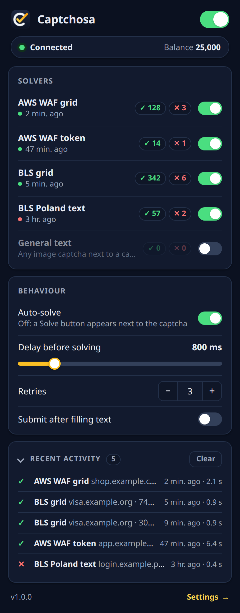
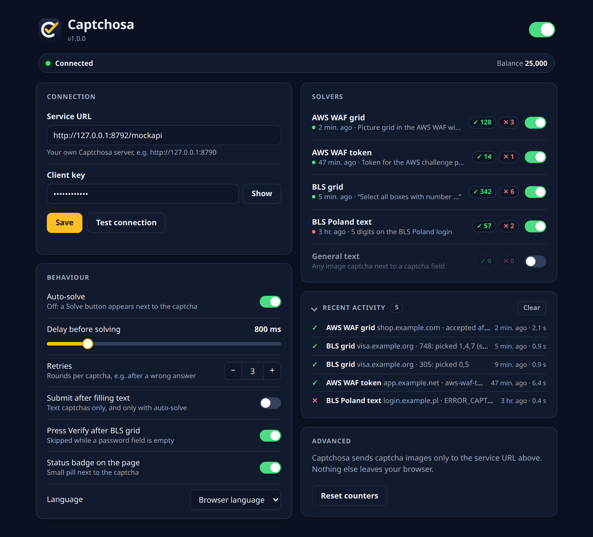

# Captchosa browser extension

Chrome / Chromium (Manifest V3) extension for the self-hosted **Captchosa** captcha service
(`aws_capsolver` in this repository). It detects captchas in the page, sends them to **your own
service URL only**, and applies the answer the way a person would.

| Popup (light) | Popup (dark) |
| --- | --- |
|  |  |




In manual mode a branded badge with a **Solve** button sits next to the captcha:


## Solvers

| Solver | Where | Service task |
| --- | --- | --- |
| AWS WAF grid | `awswaf-captcha` widget (page, iframe, open or closed shadow root) | `AwsWafClassification` (`aws:grid:<target>`) |
| AWS WAF token | challenge pages with `window.gokuProps` + `challenge.js` | `AntiAwsWafTaskProxyLess` → `aws-waf-token` cookie |
| BLS grid | `.box-label` + `img.captcha-img` (BLS Spain etc.) | `BlsClassification` (`bls:grid:NNN`, 9 tiles in page order) |
| BLS Poland text | `img[src*=captcha]` + `input[name=captcha_code]` | `ImageToTextTask`, module `bls_poland` |
| General text (off by default) | image next to a captcha/code input | `ImageToTextTask`, module `common` |

How each one works:

- **AWS WAF grid** – `content/hook_main.js` runs in the page's main world at `document_start` and
  observes (never changes) the widget's own `GET …/problem` and `POST …/verify` answers, so the
  exact `assets.images` / `assets.target` are used instead of scraping canvases. The isolated
  script finds the 9 cells and the Confirm button, clicks the returned tiles with a pointer/mouse
  event sequence, and follows wrong-answer rounds up to *Retries*. Toy-car and audio puzzles are
  reported as unsupported.
- **BLS grid** – only labels and tiles that are visible *and* win a centre hit-test count (BLS hides
  decoys with `display`, `visibility`, `opacity`, off-screen positions and stacking). Verify is
  pressed only when *Press Verify after BLS grid* is on and no password field is empty.
- **Text captchas** – the image is read from the already loaded `` through a canvas; it is
  never requested again (that would change the captcha). The value is set with `input`/`change`
  events. The form is submitted only with *Auto-solve* **and** *Submit after filling text*.

## Install

1. `chrome://extensions` → enable **Developer mode**.
2. **Load unpacked** → choose this `extension/` folder (or unzip a build from `dist/`).
3. The settings page opens: enter the **Service URL** (default `http://127.0.0.1:8790`) and your
   **client key** from the service's `keys.json`, press **Save**, then **Test connection**.
   For a non-localhost URL Chrome asks for access to that one origin.

Settings apply live; no page reload is needed.

## Privacy and permissions

- `storage` only, plus host access to `127.0.0.1` / `localhost`; any other service origin is
  requested at runtime (optional host permission) for exactly the URL you enter.
- All network calls go from the service worker to the configured service URL (`/createTask`,
  `/getTaskResult`, `/getBalance`, `/health`), each with a timeout. Nothing else is contacted.
- No remote code, no `eval`; the page scripts run on all http(s) pages because captchas can appear
  anywhere, and stay passive until a known captcha shows up.
- Errors are typed (`NETWORK_ERROR`, `TIMEOUT`, `PERMISSION_MISSING`, `NOT_CONFIGURED`, the
  service's `ERROR_*` codes, `WIDGET_NOT_FOUND`, `IMAGE_TAINTED`, …) and shown in the badge, the
  toolbar title and the activity log.

## Development

```bash
# end-to-end test: local fixtures + the real service on 127.0.0.1:8791 (Playwright Chromium)
.venv/bin/python extension/test/run_e2e.py            # --headed to watch, --grids N
# README screenshots (light + dark)
.venv/bin/python extension/test/screenshots.py
# icons from the SVG mark / locale files from tools/locales.py
python3 extension/tools/make_icons.py
python3 extension/tools/locales.py
# validate, bump the version and pack dist/captchosa-extension-<version>.zip
python3 extension/tools/build_extension.py --check
python3 extension/tools/build_extension.py patch      # or minor / major, or nothing to just pack
```

The fixtures (`test/fixtures/`, `test/fixture_server.py`) imitate the AWS widget (mocked
`/problem` + `/verify` from `data/samples/problem_visual.json`), the BLS grid (real tiles from
`bls_capsolver/data/real` with hidden, covered and off-screen decoys) and the BLS Poland login.
No third-party site is visited.

## Known limits

- Clicks are synthetic DOM events (`isTrusted === false`); a widget that rejects untrusted events
  would need the debugger API, which this extension deliberately does not use.
- The AWS token is solved by the service with its own network path; the cookie is set for the
  current host and the browser's user agent is passed along. A voucher-only answer cannot be used.
- Cross-origin text-captcha images without CORS cannot be read (`IMAGE_TAINTED`).
- The AWS widget's real DOM may change; detection looks for any group of N similar cells inside
  the widget plus a Confirm/Verify button, with a single-canvas coordinate fallback.
