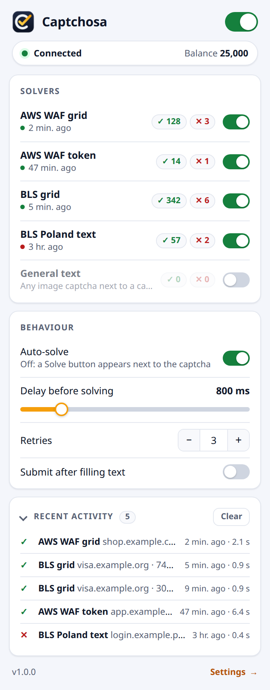
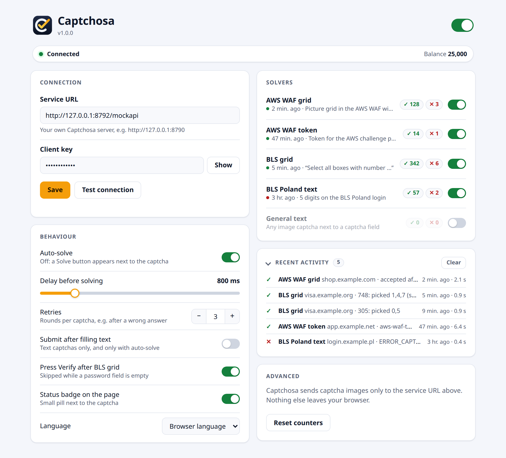
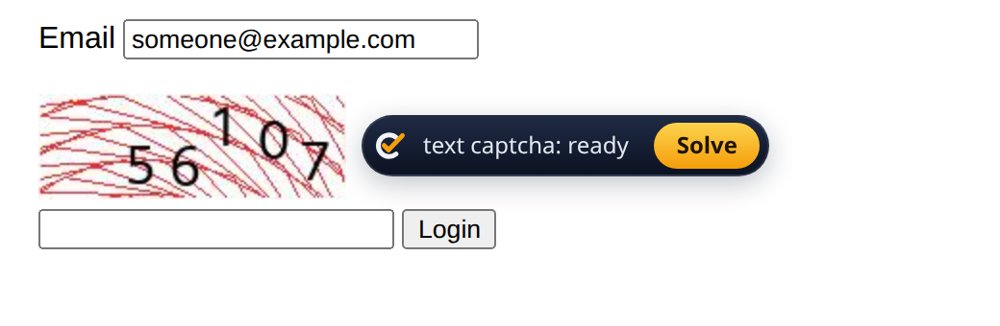

# Captchosa browser extension

Chrome / Chromium (Manifest V3) extension for the self-hosted **Captchosa** captcha service
(`aws_capsolver` in this repository). It detects captchas in the page, sends them to **your own
service URL only**, and applies the answer the way a person would.

| Popup (light) | Popup (dark) |
| --- | --- |
|  |  |




In manual mode a branded badge with a **Solve** button sits next to the captcha:



## Solvers

| Solver | Where | Service task |
| --- | --- | --- |
| AWS WAF grid | `awswaf-captcha` widget (page, iframe, open or closed shadow root) | `AwsWafClassification` (`aws:grid:<target>`) |
| AWS WAF token | challenge pages with `window.gokuProps` + `challenge.js` | `AntiAwsWafTaskProxyLess` → `aws-waf-token` cookie |
| BLS grid | `.box-label` + `img.captcha-img` (BLS Spain etc.) | `BlsClassification` (`bls:grid:NNN`, 9 tiles in page order) |
| BLS Poland text | `img[src*=captcha]` + `input[name=captcha_code]` | `ImageToTextTask`, module `bls_poland` |
| GeeTest | GeeTest v3 popup (`.geetest_canvas_bg` + `.geetest_slider_button`, `.geetest_item_img` + `.geetest_commit`) and v4 box (`.geetest_bg`, `.geetest_btn`, `.geetest_item`, `.geetest_submit`, hashed class suffixes too) | `GeeTestClassification` (`geetest:slide`, `geetest:icon`, `geetest:word`, `geetest:space`, `geetest:nine[:<word>]`, `geetest:gobang`) |
| reCAPTCHA v2 | image challenge in the `…/recaptcha/(api2\|enterprise)/bframe` iframe (www.google.com, www.recaptcha.net): `#rc-imageselect`, `table.rc-imageselect-table-33` / `-44`; the checkbox in `…/anchor` | `ReCaptchaV2Classification` (one picture + the object name from the instruction, `size` 3 / 4 / 1) |
| General text (on by default) | any picture (`img`, `canvas`, `input[type=image]`, captcha background image; also in open shadow roots) paired with a nearby captcha-like text input | `ImageToTextTask`, module `common` |

How each one works:

- **AWS WAF grid** – `content/hook_main.js` runs in the page's main world at `document_start` and
  observes (never changes) the widget's own `GET …/problem` and `POST …/verify` answers, so the
  exact `assets.images` / `assets.target` are used instead of scraping canvases. The isolated
  script finds the 9 cells and the Confirm button, clicks the returned tiles with a pointer/mouse
  event sequence, and follows wrong-answer rounds up to *Retries*. Toy-car and audio puzzles are
  reported as unsupported.
- **BLS grid** – only labels and tiles that are visible *and* win a centre hit-test count (BLS hides
  decoys with `display`, `visibility`, `opacity`, off-screen positions and stacking). Verify is
  pressed only when *Press Verify after BLS grid* is on and no password field is empty.
- **GeeTest** (`content/geetest.js`) – with *Auto-solve* the "click to verify" button (v3 radar,
  v4 `geetest_btn_click`) is pressed once, then the puzzle type is taken from GeeTest's class names
  (`geetest_slide` / `geetest_icon` / `geetest_word` / `geetest_nine` / `geetest_winlinze`…) or
  from the layout. Pictures are read from the page: v3 canvases directly, `` through a
  canvas, CSS background pictures from the memory cache (cross-origin ones with CORS, as GeeTest's
  CDN allows); only when that fails is the element cut out of a tab screenshot (top frame, needs
  *Allow on all sites*). Answers are applied like a person: the slider is dragged along a
  minimum-jerk path with a slow vertical wobble, a small overshoot and a settle-back, 0.7–2.2 s in
  total, with pointer **and** mouse events; the drag is closed-loop (it measures how far the piece
  really moved, so the piece/handle ratio of v3 and v4 does not matter). Click puzzles get paced
  clicks at the returned points (scaled from picture pixels to the element), nine-grid cells and
  gobang moves are clicked, then Confirm / Submit. A fresh puzzle after the answer counts as a
  wrong round (up to *Retries*); a success class or the widget closing counts as solved.
  Token-producing GeeTest solving (gt/challenge → validate) is not done: the answer always goes
  through the real widget.
- **reCAPTCHA v2** (`content/recaptcha.js`) – runs only inside reCAPTCHA's own frames. With
  *Auto-solve* the "I'm not a robot" checkbox is clicked once (once more after it expired). In the
  challenge frame the object comes from the instruction (`.rc-imageselect-desc(-no-canonical)
  strong`, any language), the payload picture (`img.rc-image-tile-33` / `-44`, one picture for the
  whole grid) is read from the page - it is same-origin inside the frame, so no extra permission
  and no new request - and sent as one `ReCaptchaV2Classification`. The returned cells are clicked
  with paced pointer clicks; in a dynamic 3x3 every replaced tile (`img.rc-image-tile-11`) is
  classified on its own (`size: 1`) and clicked while it still shows the object, then Verify is
  pressed. "Please try again" / a new picture after Verify is a wrong round; an unknown object
  (`unsupported question`) or no answer presses reload; a picture that stays with an error or
  without any reaction is reloaded; at most 8 failed rounds and 24 pictures per challenge. A
  picture is read only after the instruction and the picture have stayed the same for 0.6 s and
  the payload URL was not answered before (the live frame swaps the instruction up to ~1 s before
  the picture). An empty answer is sent as *Skip* only where reCAPTCHA offers it (4x4, or an
  instruction that says "skip"); on a 3x3 it means the model missed the object, so the picture is
  reloaded instead of a certain "Please select all matching images". Success
  is the checkbox turning ticked (the checkbox frame tells the challenge frame through the service
  worker; a hidden challenge frame cannot see it closing itself). No token is produced or injected
  and nothing tries to hide automation from Google: the visible challenge is solved like a user.
- **Text captchas** – the general solver pairs a picture with a text input. An input counts when
  its name/id/placeholder/aria-label, its `<label>` or the text around it talks about a captcha /
  security / verification code (English, Turkish, Azerbaijani, Russian wording); a picture counts
  when its attributes look like a captcha (`captcha`, `kaptcha`, `securimage`, `vcode`, `checkcode`,
  `code.php`…) or, next to such an input, when it is wide and short. Usernames, passwords, e-mail,
  search, phone, OTP and similar fields are never used. The picture is read from the page (an
  `` through a canvas, a `<canvas>` directly) and never requested again (that would change the
  captcha). Cross-origin pictures cannot be read that way: they are cut out of a screenshot of the
  visible tab, which needs **Options → Advanced → Allow on all sites** once (without it the pill
  shows `CAPTURE_DENIED`). While solving, the input's placeholder reads *Solving…*; the answer is
  then typed in with `input`/`change` events. The form is submitted only with *Auto-solve*
  **and** *Submit after filling text*.

## Install

1. `chrome://extensions` → enable **Developer mode**.
2. **Load unpacked** → choose this `extension/` folder (or unzip a build from `dist/`).
3. The settings page opens: enter the **Service URL** (default `http://127.0.0.1:8790`) and your
   **client key** from the service's `keys.json`, press **Save**, then **Test connection**.
   For a non-localhost URL Chrome asks for access to that one origin.

Settings apply live; no page reload is needed.

## Privacy and permissions

- `storage` only, plus host access to `127.0.0.1` / `localhost`; any other service origin is
  requested at runtime (optional host permission) for exactly the URL you enter.
- All network calls go from the service worker to the configured service URL (`/createTask`,
  `/getTaskResult`, `/getBalance`, `/health`), each with a timeout. Nothing else is contacted.
- reCAPTCHA needs no extra permission: the content scripts already run in every http(s) frame
  (`all_frames`), and inside Google's challenge frame the picture is same-origin.
- No remote code, no `eval`; the page scripts run on all http(s) pages because captchas can appear
  anywhere, and stay passive until a known captcha shows up.
- Errors are typed (`NETWORK_ERROR`, `TIMEOUT`, `PERMISSION_MISSING`, `NOT_CONFIGURED`, the
  service's `ERROR_*` codes, `WIDGET_NOT_FOUND`, `IMAGE_TAINTED`, …) and shown in the badge, the
  toolbar title and the activity log.

## Development

```bash
# end-to-end test: local fixtures + the real service on 127.0.0.1:8791 (Playwright Chromium)
.venv/bin/python extension/test/run_e2e.py            # --headed to watch, --grids N
# README screenshots (light + dark)
.venv/bin/python extension/test/screenshots.py
# icons from the SVG mark / locale files from tools/locales.py
python3 extension/tools/make_icons.py
python3 extension/tools/locales.py
# validate, bump the version and pack dist/captchosa-extension-<version>.zip
python3 extension/tools/build_extension.py --check
python3 extension/tools/build_extension.py patch      # or minor / major, or nothing to just pack
```

The fixtures (`test/fixtures/`, `test/fixture_server.py`) imitate the AWS widget (mocked
`/problem` + `/verify` from `data/samples/problem_visual.json`), the BLS grid (real tiles from
`bls_capsolver/data/real` with hidden, covered and off-screen decoys), the BLS Poland login and
GeeTest v3 (slide with a rejected first round, word click) and v4 (slide, icon, nine-grid, gobang)
against a mocked `GeeTestClassification`; the GeeTest pages check the drop position / click order
themselves and log the drag (moves, duration, vertical range, overshoot). The reCAPTCHA fixture
(`recaptcha.html` hosting cross-origin `recaptcha_anchor.html` + `recaptcha_bframe.html`) covers a
static 3x3, "Please try again", an unsupported object (reload), 4x4 and a dynamic 3x3 against a
mocked `ReCaptchaV2Classification`, plus an instruction that changes ~1 s before its picture and a
3x3 where nothing is found (`--only recaptcha` runs just that group).
No third-party site is visited.

`test/live_recaptcha.py` is the only script that visits a real site: a public solver demo page
(default `https://2captcha.com/demo/recaptcha-v2`, fresh profile, no accounts). The extension
talks to a recording proxy started by the script, which forwards everything to the real service
and saves each classified picture with its question, size, answer and reCAPTCHA's reaction into
`data/recaptcha/live/` (`index.jsonl`, `runs.jsonl`, `img/`; git-ignored). It reads the
cross-origin frames read-only over the DevTools port (Playwright does not list them), paces
attempts (>= 20 s, at most 40 per run) and stops at Google's "automated queries" page:

    CAPTCHOSA_KEY=CX-... .venv/bin/python extension/test/live_recaptcha.py --attempts 15

## Known limits

- Clicks are synthetic DOM events (`isTrusted === false`); a widget that rejects untrusted events
  would need the debugger API, which this extension deliberately does not use.
- The AWS token is solved by the service with its own network path; the cookie is set for the
  current host and the browser's user agent is passed along. A voucher-only answer cannot be used.
- Cross-origin text-captcha images without CORS cannot be read (`IMAGE_TAINTED`).
- GeeTest's DOM is reproduced from its public widgets in the local fixtures
  (`test/fixtures/geetest_v3.html`, `geetest_v4.html`); class names on a live site may differ.
  GeeTest also scores the drag itself, and synthetic (`isTrusted === false`) events may be
  rejected by its risk engine even when the position is right. The v3 "match" and v4 "match" /
  "ai" types are not supported.
- reCAPTCHA's DOM is reproduced from the live widget in the local fixtures; Google may change
  class names. Its risk engine decides how many pictures it shows (or whether it blocks with
  "Try again later"); that is not worked around. The `rc-imageselect-table-42` layout and the
  "select around the object" variant without a 3x3 / 4x4 table are reloaded, not solved.
- The AWS widget's real DOM may change; detection looks for any group of N similar cells inside
  the widget plus a Confirm/Verify button, with a single-canvas coordinate fallback.
